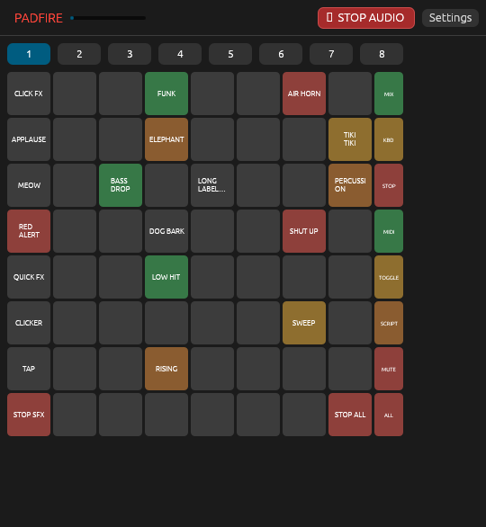
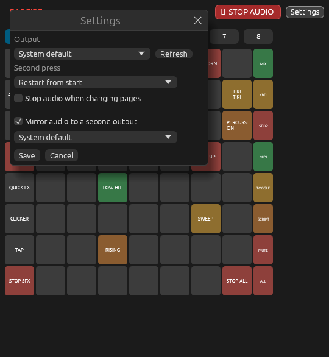

# Padfire Rust final-build candidate - visual review

**Review state:** candidate for user inspection; not a published release and not a production cutover.

**Reviewed version:** `3.0.0` (the screenshots remain an archived pre-release UI review fixture)

**Review branch:** `ui/launchpad-native-feel-2026-11-22`

These images are screenshots of the actual Rust desktop application, captured in an isolated Xvfb display with a synthetic review-only pad map. MIDI hardware is disabled, audio is not played, and no user configuration or live KDE session is used.

## Launchpad grid

## Settings

## What is being reviewed

- Fixed Launchpad pad geometry with labels wrapped inside each face.
- Centered tactile press feedback with stable input hit targets; held presses do not repeat and distinct rapid presses retrigger.
- Green/red PADFIRE connection identity and a clear Stop Audio control.
- Compact Settings with monitor configuration located alongside other audio options.
- Removal of persistent help lines, explanatory implementation text and footer/status chrome.
- Native system light/dark theme handling.

The same screenshot pair is regenerated by the `UI / Linux render and screenshots` GitHub Actions job. Download the `padfire-ui-review` artifact on the PR to inspect the runner-generated captures and render log.

Physical Launchpad LED/input, audio routing, suspend/reconnect and Windows acceptance remain separate hardware gates. CI and these screenshots do not claim those tests have passed.
